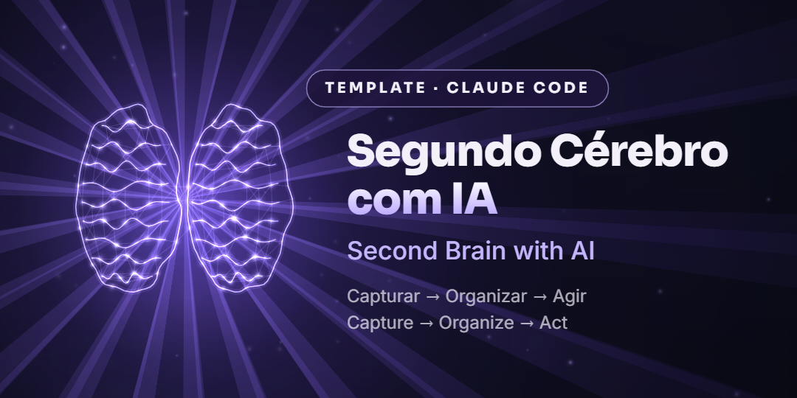

<p align="center">
  
</p>

<p align="center">
  <a href="README.pt-BR.md">🇧🇷 Português</a> · <b>🇺🇸 English</b>
</p>

# 🧠 Second Brain with AI

A "second brain" made of folders and Markdown files, built to use with **Claude Code**.
Get everything out of your head, and the AI captures, organizes, reviews your week and suggests your next actions.

> **Capture → Organize → Act**

No database, no new app, no subscription: just folders and text files you control.

---

## ⚡ Get started in 2 minutes

1. **Download only the English version** (pick one):
   - **No terminal:** click **Code → Download ZIP**, unzip it and use the `en/` folder.
   - **With Node.js:**
     ```bash
     npx degit jmarques-data/segundo-cerebro-ia/en my-second-brain
     ```
   - **With Git:**
     ```bash
     git clone https://github.com/jmarques-data/segundo-cerebro-ia.git
     cd segundo-cerebro-ia/en
     ```
2. **Open the `en/` folder** (or the folder you created) in **Claude Code**: terminal, VS Code or the desktop app.
   > ⚠️ Open the language folder, not the repository root. That's where `CLAUDE.md` and the commands live.
3. **Try it:** type `/capture my first idea` and watch the note appear in `00-inbox/`.

---

## 🗂️ Structure

| Folder | What it's for |
|---|---|
| `00-inbox/` | Quick capture, no organizing |
| `01-active-projects/` | One file per project (status, next steps, deadline) |
| `02-skills/` | Reusable skills and processes |
| `03-agents/` | Agents and automations |
| `04-personal-life/` | Hobbies, goals, habits |
| `05-life/` | Studies, faith, relationships (rename as you like) |
| `06-career/` | Work, LinkedIn and job applications (one note per job) |
| `07-video-editor/` | Scripts and videos |
| `99-archive/` | Everything that's done (nothing is deleted) |

**8 areas, 3 commands and 1 rules file.**

## ⌨️ Commands

| Command | What it does |
|---|---|
| `/capture <text>` | Saves a note to `00-inbox/` with date, tags and status. |
| `/weekly-review` | Reads what changed in the last 7 days, flags pending items and proposes **3 next actions**. |
| `/jobs-status` | Summarizes the job applications in `06-career/jobs/` grouped by status. |

The commands live in `en/.claude/commands/`. Edit them freely or create new ones.

## 📜 System rules (`CLAUDE.md`)

- Everything in English.
- Every note has frontmatter with `date`, `tags` and `status`.
- Claude **shows the change and waits for your confirmation** before editing a file.
- **Never deletes:** finished items go to `99-archive/`.
- Never stores passwords, bank details, ID documents or health data.
- Uses the templates `_project-template.md`, `_job-template.md` and `_video-template.md`.

## 💡 Tips

- **First step:** ask *"ask me questions to fill in my second brain"* and answer at your own pace.
- **Weekly review:** in the Claude app, schedule a task (for example, Sundays at 8 PM) that runs `/weekly-review`.
- **Calendar, Gmail and Drive:** with Claude's connectors, the AI can use your calendar and files to organize your week. This is optional: the template works with just the folders.
- **Make it yours:** rename areas, delete the ones you don't use and create your own. The rules in `CLAUDE.md` are yours too.

## ❓ FAQ

**Does it cost anything?** The template is free (MIT license). You just need access to Claude Code.

**Does it work with Obsidian?** Yes. They're plain Markdown files: open the same folder in Obsidian to read and browse.

**Where does my data go?** Your notes stay on your computer. Claude reads the files in the folder while it works in it.

## 🤝 Contributing

Ideas, fixes and new commands are welcome: open an *issue* or a *pull request*.
If this project helped you, leave a ⭐. It helps the template reach more people.

## 📄 License

[MIT](LICENSE). Use it, adapt it, share it.
