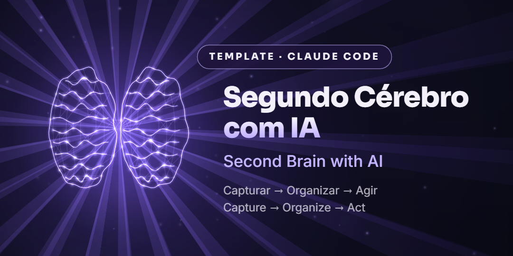

<p align="center">
  
</p>

<p align="center">
  <a href="README.pt-BR.md"><b>🇧🇷 Português</b></a> · <a href="README.en.md"><b>🇺🇸 English</b></a>
</p>

<p align="center">
  
  
  
</p>

---

### 🇧🇷 Português

Um **segundo cérebro** em pastas e arquivos Markdown, feito para usar com o **Claude Code**.
Você tira tudo da cabeça, e a IA captura, organiza, revisa a semana e sugere as próximas ações.

**Comece pela pasta [`pt-BR/`](pt-BR/)** · [Guia completo em português →](README.pt-BR.md)

### 🇺🇸 English

A **second brain** made of folders and Markdown files, built to use with **Claude Code**.
Get everything out of your head, and the AI captures, organizes, reviews your week and suggests your next actions.

**Start with the [`en/`](en/) folder** · [Full guide in English →](README.en.md)

---

```
segundo-cerebro-ia/
├── pt-BR/   🇧🇷 modelo em português   (/capturar, /revisar-semana, /vagas-status)
├── en/      🇺🇸 template in English   (/capture, /weekly-review, /jobs-status)
└── docs/    imagens / images
```

<p align="center"><b>IA não é só chat. É sistema.</b> · <i>AI isn't just chat. It's a system.</i></p>
