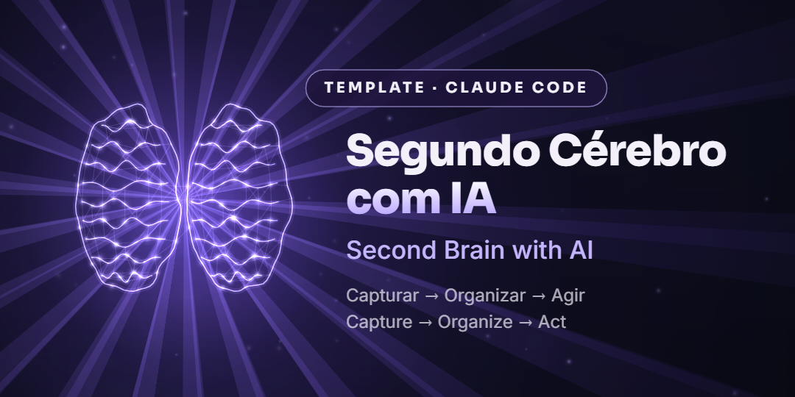

<p align="center">
  
</p>

<p align="center">
  <b>🇧🇷 Português</b> · <a href="README.en.md">🇺🇸 English</a>
</p>

# 🧠 Segundo Cérebro com IA

Um "segundo cérebro" em pastas e arquivos Markdown, feito para usar com o **Claude Code**.
Você tira tudo da cabeça, e a IA captura, organiza, revisa a semana e sugere as próximas ações.

> **Capturar → Organizar → Agir**

Sem banco de dados, sem app novo, sem assinatura: são só pastas e textos que você controla.

---

## ⚡ Comece em 2 minutos

1. **Baixe só a versão em português** (escolha uma opção):
   - **Sem terminal:** clique em **Code → Download ZIP**, descompacte e use a pasta `pt-BR/`.
   - **Com Node.js:**
     ```bash
     npx degit jmarques-data/segundo-cerebro-ia/pt-BR meu-segundo-cerebro
     ```
   - **Com Git:**
     ```bash
     git clone https://github.com/jmarques-data/segundo-cerebro-ia.git
     cd segundo-cerebro-ia/pt-BR
     ```
2. **Abra a pasta `pt-BR/`** (ou a pasta que você criou) no **Claude Code**: terminal, VS Code ou app desktop.
   > ⚠️ Abra a pasta do idioma, não a raiz do repositório. É lá que estão o `CLAUDE.md` e os comandos.
3. **Teste:** digite `/capturar minha primeira ideia` e veja a nota aparecer em `00-inbox/`.

---

## 🗂️ Estrutura

| Pasta | Para quê |
|---|---|
| `00-inbox/` | Captura rápida, sem organização |
| `01-projetos-ativos/` | Um arquivo por projeto (status, próximos passos, prazo) |
| `02-skills/` | Skills e processos reutilizáveis |
| `03-agents/` | Agentes e automações |
| `04-vida-pessoal/` | Hobbies, metas, hábitos |
| `05-vida/` | Estudos, fé, relacionamentos (renomeie à vontade) |
| `06-carreira/` | Trabalho, LinkedIn e vagas (uma nota por vaga) |
| `07-editor-videos/` | Roteiros e vídeos |
| `99-arquivo/` | O que foi concluído (nada é apagado) |

**8 áreas, 3 comandos e 1 arquivo de regras.**

## ⌨️ Comandos

| Comando | O que faz |
|---|---|
| `/capturar <texto>` | Salva uma nota no `00-inbox/` com data, tags e status. |
| `/revisar-semana` | Lê o que mudou em 7 dias, aponta pendências e propõe **3 próximas ações**. |
| `/vagas-status` | Resume as vagas de `06-carreira/vagas/` agrupadas por status. |

Os comandos ficam em `pt-BR/.claude/commands/`. Edite à vontade ou crie novos.

## 📜 Regras do sistema (`CLAUDE.md`)

- Tudo em português brasileiro.
- Toda nota tem frontmatter com `data`, `tags` e `status`.
- O Claude **mostra a alteração e espera sua confirmação** antes de editar um arquivo.
- **Nunca apaga:** o que foi concluído vai para `99-arquivo/`.
- Não registra senhas, dados bancários, documentos ou dados de saúde.
- Usa os modelos `_modelo-projeto.md`, `_modelo-vaga.md` e `_modelo-video.md`.

## 💡 Dicas

- **Primeiro passo:** peça *"me faça perguntas para preencher meu segundo cérebro"* e responda no seu ritmo.
- **Revisão semanal:** no app do Claude, agende uma tarefa (por exemplo, domingo às 20h) rodando `/revisar-semana`.
- **Agenda, Gmail e Drive:** com os conectores do Claude, a IA pode usar sua agenda e seus arquivos para organizar a semana. Isso é opcional: o modelo funciona só com as pastas.
- **Personalize:** renomeie as áreas, apague as que não usa e crie as suas. As regras do `CLAUDE.md` também são suas.

## ❓ Perguntas frequentes

**Preciso pagar alguma coisa?** O modelo é grátis (licença MIT). Você só precisa ter acesso ao Claude Code.

**Funciona com Obsidian?** Sim. São arquivos Markdown comuns: abra a mesma pasta no Obsidian para ler e navegar.

**Meus dados vão para algum lugar?** As notas ficam no seu computador. O Claude lê os arquivos da pasta enquanto trabalha nela.

## 🤝 Contribua

Ideias, correções e novos comandos são bem-vindos: abra uma *issue* ou um *pull request*.
Se o projeto te ajudou, deixe uma ⭐. Isso ajuda o modelo a chegar em mais gente.

## 📄 Licença

[MIT](LICENSE). Use, adapte e compartilhe.
